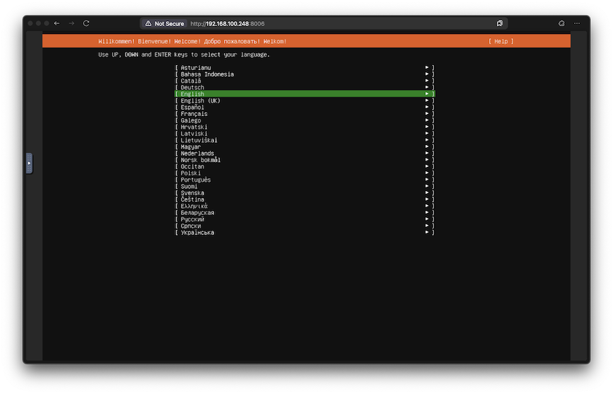
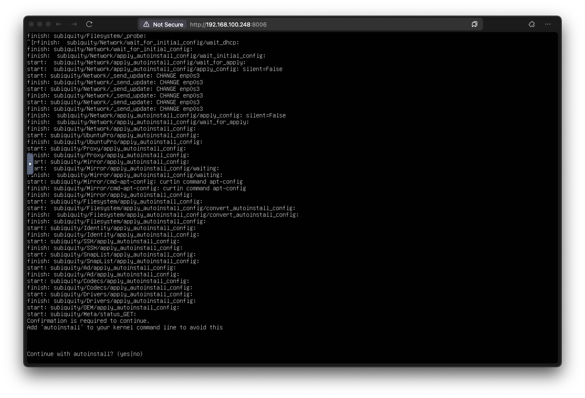
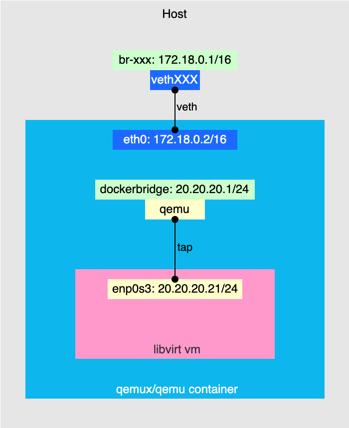
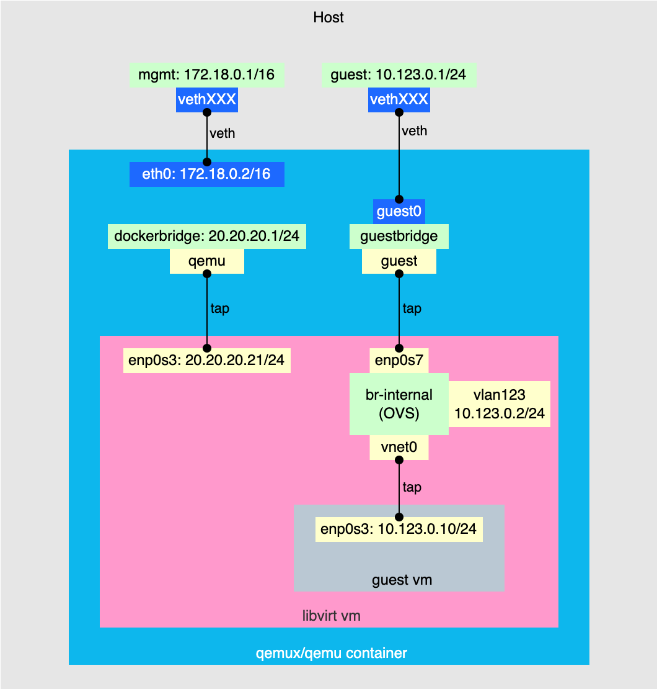

# Running libvirt host in Docker

<figure markdown>
  [](https://unsplash.com/@seanstratton)
  <figcaption>Cover photo by Sean Stratton on Unsplash</figcaption>
</figure>

In this article, I would like to share my experience of creating a test libvirt environment in a Docker container.
I will be covering topics such as running qemu in Docker, making unattended Ubuntu installations, stitching VM networks with container and host networks, creating disk pools, and more.
So if you're curious about those things or want to know my motivation behind building such an intricate setup please read along.

<!-- more -->

!!! tip
    I've created a [repository](https://github.com/dteslya/libvirt-in-docker) that you can refer to while reading this article.
    It includes a `docker compose` file and a set of helper shell scripts to automate the whole setup.

## Motivation... or how I ended up running VMs on a VM in a container

While developing an internal tool that interacts with libvirt API to manage VMs on virtualization hosts I needed an environment to test it.

I had these main requirements for the virtualization host in test environment:

* LVM-based storage pools
* Open vSwitch networking for guest VMs
* Guest VM IPs routable from host
* SSH access to guest VMs

Having a dedicated baremetal server was too expensive so I considered virtualization options.
My first idea was to use Vagrant, but I found it cumbersome, too coupled with the host system, and potentially hard to run in a CI pipeline.
So the next obvious choice was Docker, since I have [some experience](2024-03-containerlab.md) running VMs in containers.

First, I tried to run libvirtd directly in a container to make it more lightweight.
That warranted some unconventional container setup because I needed to run more that one daemon, namely libvirtd and sshd.
There are different solutions for that, such as [tini](https://github.com/krallin/tini), [supervisord](https://supervisord.org/), and [s6](https://github.com/just-containers/s6-overlay).
After some research I found s6 the most straightforward and easy to set up.

The next task was to configure LVM.
Using a loop device I was able to mount a disk image file as a disk device. Then I tried to use that disk to create a volume group.
However, I learned that udev was required to automatically create device mappings in `/dev`.
That was too much, and I resorted to an even more nested solution - running VM in a container and using that VM as a virtualization host for guest VMs.
That eliminated the extra effort needed to replicate libvirtd behavior in Docker and provided better environment isolation from the host as opposed to running a VM directly.

In the next sections, I will guide you through the whole setup process.

## Running QEMU VM in Docker

Running VMs in Docker containers is not that uncommon, e.g., containerlab does exactly that with a number of network operating systems.
This gave me hope that I could make a shortcut here and not waste time reinventing the wheel.
So I just googled "qemu in docker" and clicked the first link.
That led me to the [QEMU in a Docker container](https://github.com/qemus/qemu) project.
After reading the docs and following the examples I found it perfect for my needs.

For the first test run, I used this slightly modified Docker compose file from the project's README:

```yaml title="docker-compose.yml"
---
services:
  libvirt:
    image: qemux/qemu:7.12
    container_name: libvirt
    environment:
      BOOT: ubuntus
      RAM_SIZE: "8G"
      CPU_CORES: "2"
      DEBUG: "Y"
    devices:
      - /dev/kvm
      - /dev/net/tun
    cap_add:
      - NET_ADMIN
    ports:
      - 8006:8006 # web console
      - 2222:22 # ssh to libvirt vm
    volumes:
      - ./qemu:/storage # VM disks and ISOs are stored here
    restart: always
    stop_grace_period: 2m
```

Running this with `docker compose up` brings you to Ubuntu Server installation screen when you connect to the VNC console available at `http://<host_ip>:8006`.

<figure markdown>
  
  <figcaption>Ubuntu Server installer</figcaption>
</figure>

??? note
    When the container is started it downloads the Ubuntu Server LiveCD to `/storage` directory and uses it to boot the VM.

From there I was supposed to manually finish the installation.

## Host OS unattended installation
 
Apparently, I needed a way to automate the OS installation and eliminate any manual interaction.
Ubuntu supports unattended installation by means of [autoinstall](https://canonical-subiquity.readthedocs-hosted.com/en/latest/intro-to-autoinstall.html).
The autoinstall configuration can be provided to the installer via [cloud-init](https://canonical-subiquity.readthedocs-hosted.com/en/latest/tutorial/providing-autoinstall.html#providing-autoinstall) and [NoCloud](https://docs.cloud-init.io/en/latest/reference/datasources/nocloud.html#source-2-drive-with-labeled-filesystem) data source.
In other, words I just needed to mount an ISO labeled `CIDATA` that contained the autoinstall configuration.

Fortunately, the `qemux/qemu` image has a way to modify QEMU command line arguments and with that, it's possible to attach an ISO with autoinstall configuration to the VM.
But first I needed to generate the ISO file.
To my luck, I wasn't the first who needed that and I've found an [example script](https://github.com/qemus/qemu/issues/649) in the project issues page.

Here's what I came up with using that example:

```bash title="host machine"
mkdir cloud-init

cat >./cloud-init/user-data <<EOF
#cloud-config
autoinstall:
  version: 1
  package_update: true
  package_upgrade: true
  packages:
    - sudo
    - bridge-utils
    - dmidecode
    - dnsmasq
    - ebtables
    - iproute2
    - iptables
    - libvirt-clients
    - libvirt-daemon-system
    - virtinst
    - genisoimage
    - ovmf
    - qemu-efi
    - qemu-kvm
    - openssh-server
    - xz-utils
    - lvm2
    - openvswitch-switch
  user-data:
    hostname: ubuntu-server
    users:
      - name: ubuntu
        plain_text_passwd: ubuntu
        groups: sudo, libvirt
        shell: /bin/bash
        lock_passwd: False
EOF

cat <<EOF >./cloud-init/meta-data
instance-id: ubuntu-server
EOF

genisoimage -input-charset utf-8 -output ./cloud-init/seed.iso -volid cidata -joliet -rock ./cloud-init/*
```

This creates the `cloud-init` directory and puts the resulting `seed.iso` image with autoinstall configuration there.
The configuration itself instructs the installer and cloud-init to install necessary packages for libvirtd, LVM, and Open vSwitch, and creates the `ubuntu` user with `ubuntu` password.

To make use of this ISO image it needs to be attached to VM as a drive.
Here is the updated `docker-compose.yml`:

```yaml title="docker-compose.yml" hl_lines="11 22"
---
services:
  libvirt:
    image: qemux/qemu:7.12
    container_name: libvirt
    environment:
      BOOT: ubuntus
      RAM_SIZE: "8G"
      CPU_CORES: "2"
      DEBUG: "Y"
      ARGUMENTS: "-drive file=/cloud-init/seed.iso,format=raw,cache=none,if=virtio"
    devices:
      - /dev/kvm
      - /dev/net/tun
    cap_add:
      - NET_ADMIN
    ports:
      - 8006:8006 # web console
      - 2222:22 # ssh to libvirt vm
    volumes:
      - ./qemu:/storage # VM disks and ISOs are stored here
      - ./cloud-init:/cloud-init # seed.iso is stored here
    restart: always
    stop_grace_period: 2m
```

But Ubuntu autoinstall has a safeguard feature designed to prevent accidental disk erasure.
Even when there is an autoinstall configuration provided it waits for user confirmation to proceed.
Quoting the [documentation](https://canonical-subiquity.readthedocs-hosted.com/en/latest/howto/autoinstall-quickstart.html#id4):

>The installer prompts for a confirmation before modifying the disk.
To skip the need for a confirmation, interrupt the booting process, and add the autoinstall parameter to the kernel command line.

Here is how it looks:

<figure markdown>
  
  <figcaption>Ubuntu Server installer waiting for user confirmation to proceed</figcaption>
</figure>

To bypass this, as mentioned in the documentation, one needs to add the `autoinstall` parameter to the kernel boot command.

To make the installation completely unattended I had to modify the installation ISO to somehow add the `autoinstall` argument to the kernel boot command.
After some digging, I've found a [Python utility](https://github.com/mwhudson/livefs-editor) called `livefs-edit` that does exactly that.
Since it depends on some additional packages, I decided to run it in a one-time Docker container.

=== "Script"

    ```bash
    mkdir ./images
    curl -fLo ./images/ubuntu-24.04.2-live-server-amd64.iso https://releases.ubuntu.com/noble/ubuntu-24.04.2-live-server-amd64.iso
    docker run --rm -it \
      --privileged \
      --tmpfs /tmp \
      -v "./images:/images" \
      ubuntu:24.04 \
      bash -c "
        export DEBIAN_FRONTEND=noninteractive && \
        apt-get update && \
        apt-get install -y git xorriso squashfs-tools python3 python3.12-venv gpg liblz4-tool python3-pip && \
        cd /images && \
        python3 -m venv .venv && \
        source .venv/bin/activate && \
        pip3 install livefs-edit pyyaml && \
        python3 -m livefs_edit ubuntu-24.04.2-live-server-amd64.iso autoinstall.iso --add-cmdline-arg autoinstall persist=false && \
        rm -rf .venv
      "
    ```

=== "Output"

    ```
    <skipped>
    Collecting livefs-edit
      Downloading livefs_edit-0.0.4-py3-none-any.whl.metadata (7.6 kB)
    Collecting pyyaml
      Downloading PyYAML-6.0.2-cp312-cp312-manylinux_2_17_x86_64.manylinux2014_x86_64.whl.metadata (2.1 kB)
    Downloading livefs_edit-0.0.4-py3-none-any.whl (11 kB)
    Downloading PyYAML-6.0.2-cp312-cp312-manylinux_2_17_x86_64.manylinux2014_x86_64.whl (767 kB)
      ━━━━━━━━━━━━━━━━━━━━━━━━━━━━━━━━━━━━━━━━ 767.5/767.5 kB 1.9 MB/s eta 0:00:00
    Installing collected packages: pyyaml, livefs-edit
    Successfully installed livefs-edit-0.0.4 pyyaml-6.0.2
    running add-cmdline-arg with arguments {'arg': 'autoinstall', 'persist': False}
    rewriting /tmp/tmpoq1oainw/new/iso/boot/grub/grub.cfg
    xorriso 1.5.6 : RockRidge filesystem manipulator, libburnia project.

    Drive current: -outdev 'stdio:autoinstall.iso'
    Media current: stdio file, overwriteable
    Media status : is blank
    Media summary: 0 sessions, 0 data blocks, 0 data, 76.2g free
    xorriso : WARNING : -volid text problematic as automatic mount point name
    xorriso : WARNING : -volid text does not comply to ISO 9660 / ECMA 119 rules
    xorriso : WARNING : -volid text problematic as automatic mount point name
    xorriso : WARNING : -volid text does not comply to ISO 9660 / ECMA 119 rules
    Added to ISO image: directory '/'='/tmp/tmpoq1oainw/new/iso'
    xorriso : UPDATE :    1078 files added in 1 seconds
    xorriso : UPDATE :    1078 files added in 1 seconds
    xorriso : NOTE : Copying to System Area: 32768 bytes from file '--interval:local_fs:0s-15s:zero_mbrpt,zero_gpt:ubuntu-24.04.2-live-server-amd64.iso'
    xorriso : UPDATE :  2.18% done
    xorriso : UPDATE :  12.06% done
    xorriso : UPDATE :  35.46% done
    xorriso : UPDATE :  59.67% done, estimate finish Thu Jun 05 14:22:08 2025
    xorriso : UPDATE :  78.12% done
    ISO image produced: 1568418 sectors
    Written to medium : 1568418 sectors at LBA 0
    Writing to 'stdio:autoinstall.iso' completed successfully.
    ```

This will produce a modified LiveCD named `./images/autoinstall.iso`.

Now this modified ISO can be used with `qemux/qemu` image by mounting it inside a container as `/boot.iso`.
Here's the updated `docker-compose.yml`:

```yaml title="docker-compose.yml" hl_lines="22"
---
services:
  libvirt:
    image: qemux/qemu:7.12
    container_name: libvirt
    environment:
      RAM_SIZE: "8G"
      CPU_CORES: "2"
      DEBUG: "Y"
      ARGUMENTS: "-drive file=/cloud-init/seed.iso,format=raw,cache=none,if=virtio"
    devices:
      - /dev/kvm
      - /dev/net/tun
    cap_add:
      - NET_ADMIN
    ports:
      - 8006:8006 # web console
      - 2222:22 # ssh to libvirt vm
    volumes:
      - ./qemu:/storage # VM disks and ISOs are stored here
      - ./cloud-init:/cloud-init # seed.iso is stored here
      - ./images/autoinstall.iso:/boot.iso
    restart: always
    stop_grace_period: 2m
```

By this point I had a fully automated installation of a base system to run libvirtd.

## Storage

To store nested VMs I needed at least one dedicated disk to create a volume group and add it to libvirt [storage pool](https://libvirt.org/storage.html#logical-volume-pool).
Once again `qemux/qemu` got me covered here.
To add extra disks to the QEMU VM it's enough to add something like this to the `docker-compose.yml`:

```yaml
environment:
  DISK2_SIZE: "5G"
  DISK3_SIZE: "5G"
volumes:
  - ./disk2:/storage2
  - ./disk3:/storage3
```

This creates `./disk2/data2.img` and `./disk3/data3.img` files on the host system and `/dev/sdb` and `/dev/sdc` on the QEMU VM.


=== "Host"

    ```
    $ ls -lh disk*
    disk2:
    total 0
    -rw-r--r-- 1 root root 5.0G May 29 11:25 data2.img

    disk3:
    total 0
    -rw-r--r-- 1 root root 5.0G May 29 11:25 data3.img
    ```

=== "VM"

    ```hl_lines="11 12"
    ubuntu@ubuntu-server:~$ lsblk
    NAME                      MAJ:MIN RM  SIZE RO TYPE MOUNTPOINTS
    loop0                       7:0    0   87M  1 loop /snap/lxd/29351
    loop1                       7:1    0 38.8M  1 loop /snap/snapd/21759
    loop2                       7:2    0 63.9M  1 loop /snap/core20/2318
    sda                         8:0    0   16G  0 disk
    ├─sda1                      8:1    0  763M  0 part /boot/efi
    ├─sda2                      8:2    0  1.8G  0 part /boot
    └─sda3                      8:3    0 13.5G  0 part
      └─ubuntu--vg-ubuntu--lv 253:0    0   10G  0 lvm  /
    sdb                         8:16   0    5G  0 disk
    sdc                         8:32   0    5G  0 disk
    sr0                        11:0    1    2G  0 rom
    vda                       252:0    0  366K  0 disk
    ```

Now I could create a volume group and a storage pool out of those disks.

=== "VM"

     ```bash
     # Create physical volumes
     pvcreate /dev/sdb
     pvcreate /dev/sdc

     # Create volume group
     vgcreate vgLIBVIRT
     vgchange -a y vgLIBVIRT

     # Create pool
     virsh pool-define-as vgLIBVIRT logical - - /dev/sdb vgLIBVIRT /dev/vgLIBVIRT
     virsh pool-start vgLIBVIRT
     virsh pool-autostart vgLIBVIRT
     ```

=== "Output"

    ```bash
    Creating physical volume /dev/sdb...
      Physical volume "/dev/sdb" successfully created.
    Creating physical volume /dev/sdc...
      Physical volume "/dev/sdc" successfully created.
    Creating volume group vgLIBVIRT with disks: /dev/sdb /dev/sdc...
      Volume group "vgLIBVIRT" successfully created
      0 logical volume(s) in volume group "vgLIBVIRT" now active
    Creating pool vgLIBVIRT...
    Pool vgLIBVIRT defined

    Pool vgLIBVIRT started

    Pool vgLIBVIRT marked as autostarted
    ```

=== "Verification"

    ```
    ubuntu@ubuntu-server:~$ virsh pool-list
    Name     State    Autostart
    ------------------------------
    vgLIBVIRT   active   yes

    ubuntu@ubuntu-server-2025-05-29--0648:~$ virsh pool-info vgLIBVIRT
    Name:           vgLIBVIRT
    UUID:           51fd9e82-2339-42b7-8c1d-ae0e6cbea366
    State:          running
    Persistent:     yes
    Autostart:      no
    Capacity:       9.99 GiB
    Allocation:     0.00 B
    Available:      9.99 GiB
    ```

## Network

One of my networking requirements was using Open vSwitch to provide connectivity for nested VMs.
But first, I needed to understand how to bridge OVS to the container network and eventually to the host.

### Default configuration

This is how `qemux/qemu` network topology looks like without any customization.

<figure markdown>
  
  <figcaption>QEMU in Docker default network topology</figcaption>
</figure>

Let's take a look at what's going on here.
The upper part is standard: the `qemux/qemu` container is connected to the default Docker bridge network (br-xxx) via [veth](https://man7.org/linux/man-pages/man4/veth.4.html) interface pair.
Docker compose automatically creates DNAT rules to access services running inside the container:

```
$ sudo iptables -t nat -nvL | grep DNAT
    0     0 DNAT       6    --  !br-474398cdd1d1 *       0.0.0.0/0            0.0.0.0/0            tcp dpt:2222 to:172.18.0.2:22
    0     0 DNAT       6    --  !br-474398cdd1d1 *       0.0.0.0/0            0.0.0.0/0            tcp dpt:8006 to:172.18.0.2:8006
```

In this case, port 8006 is used to reach `nginx` running inside the container that exposes [VNC console](https://github.com/novnc/noVNC) to the QEMU VM, and port 2222 is used to reach the VM via SSH.
But you might ask how traffic destined to `172.18.0.2:22` after DNAT translation reaches the VM. Let's take a look at the interfaces inside the container.

=== "ip -d a"

    ```hl_lines="8 10 11 13 15 16 20 22"
    root@c9fa9879fa79:/# ip -d a
    1: lo: <LOOPBACK,UP,LOWER_UP> mtu 65536 qdisc noqueue state UNKNOWN group default qlen 1000
        link/loopback 00:00:00:00:00:00 brd 00:00:00:00:00:00 promiscuity 0 allmulti 0 minmtu 0 maxmtu 0 numtxqueues 1 numrxqueues 1 gso_max_size 65536 gso_max_segs 65535 tso_max_size 524280 tso_max_segs 65535 gro_max_size 65536 gso_ipv4_max_size 65536 gro_ipv4_max_size 65536
        inet 127.0.0.1/8 scope host lo
          valid_lft forever preferred_lft forever
        inet6 ::1/128 scope host proto kernel_lo
          valid_lft forever preferred_lft forever
    2: eth0@if9: <BROADCAST,MULTICAST,UP,LOWER_UP> mtu 1500 qdisc noqueue state UP group default
        link/ether 72:60:f1:0c:20:ba brd ff:ff:ff:ff:ff:ff link-netnsid 0 promiscuity 0 allmulti 0 minmtu 68 maxmtu 65535
        veth numtxqueues 8 numrxqueues 8 gso_max_size 65536 gso_max_segs 65535 tso_max_size 524280 tso_max_segs 65535 gro_max_size 65536 gso_ipv4_max_size 65536 gro_ipv4_max_size 65536
        inet 172.18.0.2/16 brd 172.18.255.255 scope global eth0
          valid_lft forever preferred_lft forever
    3: dockerbridge: <BROADCAST,MULTICAST,UP,LOWER_UP> mtu 1500 qdisc noqueue state UP group default qlen 1000
        link/ether 02:86:f2:a0:c4:68 brd ff:ff:ff:ff:ff:ff promiscuity 0 allmulti 0 minmtu 68 maxmtu 65535
        bridge forward_delay 1500 hello_time 200 max_age 2000 ageing_time 30000 stp_state 0 priority 32768 vlan_filtering 0 vlan_protocol 802.1Q bridge_id 8000.2:86:f2:a0:c4:68 designated_root 8000.2:86:f2:a0:c4:68 root_port 0 root_path_cost 0 topology_change 0 topology_change_detected 0 hello_timer    0.00 tcn_timer    0.00 topology_change_timer    0.00 gc_timer   15.64 fdb_n_learned 0 fdb_max_learned 0 vlan_default_pvid 1 vlan_stats_enabled 0 vlan_stats_per_port 0 group_fwd_mask 0 group_address 01:80:c2:00:00:00 mcast_snooping 1 no_linklocal_learn 0 mcast_vlan_snooping 0 mst_enabled 0 mcast_router 1 mcast_query_use_ifaddr 0 mcast_querier 0 mcast_hash_elasticity 16 mcast_hash_max 4096 mcast_last_member_count 2 mcast_startup_query_count 2 mcast_last_member_interval 100 mcast_membership_interval 26000 mcast_querier_interval 25500 mcast_query_interval 12500 mcast_query_response_interval 1000 mcast_startup_query_interval 3125 mcast_stats_enabled 0 mcast_igmp_version 2 mcast_mld_version 1 nf_call_iptables 0 nf_call_ip6tables 0 nf_call_arptables 0 numtxqueues 1 numrxqueues 1 gso_max_size 65536 gso_max_segs 65535 tso_max_size 65536 tso_max_segs 65535 gro_max_size 65536 gso_ipv4_max_size 65536 gro_ipv4_max_size 65536
        inet 20.20.20.1/24 brd 20.20.20.255 scope global dockerbridge
          valid_lft forever preferred_lft forever
        inet6 fe80::6cf1:bdff:fe9d:8d4d/64 scope link proto kernel_ll
          valid_lft forever preferred_lft forever
    4: qemu: <BROADCAST,MULTICAST,PROMISC,UP,LOWER_UP> mtu 1500 qdisc pfifo_fast master dockerbridge state UP group default qlen 1000
        link/ether 02:86:f2:a0:c4:68 brd ff:ff:ff:ff:ff:ff promiscuity 2 allmulti 1 minmtu 68 maxmtu 65521
        tun type tap pi off vnet_hdr on persist on
        bridge_slave state forwarding priority 32 cost 2 hairpin off guard off root_block off fastleave off learning on flood on port_id 0x8001 port_no 0x1 designated_port 32769 designated_cost 0 designated_bridge 8000.2:86:f2:a0:c4:68 designated_root 8000.2:86:f2:a0:c4:68 hold_timer    0.00 message_age_timer    0.00 forward_delay_timer    0.00 topology_change_ack 0 config_pending 0 proxy_arp off proxy_arp_wifi off mcast_router 1 mcast_fast_leave off mcast_flood on bcast_flood on mcast_to_unicast off neigh_suppress off neigh_vlan_suppress off group_fwd_mask 0 group_fwd_mask_str 0x0 vlan_tunnel off isolated off locked off mab off numtxqueues 1 numrxqueues 1 gso_max_size 65536 gso_max_segs 65535 tso_max_size 65536 tso_max_segs 65535 gro_max_size 65536 gso_ipv4_max_size 65536 gro_ipv4_max_size 65536
        inet6 fe80::86:f2ff:fea0:c468/64 scope link proto kernel_ll
          valid_lft forever preferred_lft forever

    ```

=== "ip -br a"

    ```
    root@c9fa9879fa79:/# ip -br a
    lo               UNKNOWN        127.0.0.1/8 ::1/128
    eth0@if9         UP             172.18.0.2/16
    dockerbridge     UP             20.20.20.1/24 fe80::6cf1:bdff:fe9d:8d4d/64
    qemu             UP             fe80::86:f2ff:fea0:c468/64
    ```

As you can see there are two extra interfaces: `dockerbridge` and `qemu` which are created by `qemux/qemu` bootstrap scripts.
The `qemu` is a TAP interface connected to `dockerbridge` bridge and the VM NIC.
That's where SSH service is listening. To access it from the default Docker network there are special iptables rules also created by the bootstrap scripts.

```title="NAT rules inside the container"
root@c9fa9879fa79:/# iptables -t nat -nvL | grep DNAT
    2   120 DNAT       tcp  --  eth0   *       0.0.0.0/0            172.18.0.2           multiport dports  !8006,5900 to:20.20.20.21
    0     0 DNAT       udp  --  eth0   *       0.0.0.0/0            172.18.0.2           to:20.20.20.21
```


This translates all incoming TCP and UDP traffic destination IPs to the VM IP except the traffic going to ports 8006 and 5900.
In other words when you run `ssh -p2222 ubuntu@localhost` it's first translated to `172.18.0.2:22` by the host, and then to `20.20.20.21:22` by the container.

### Adding "guest" network

So when the default network setup was clear, I had to come up with something to enable nested VM connectivity.
My idea was to leave the first default interface of the QEMU VM as it was and treat it as an OOB-management network.
As for the nested VM connectivity I decided to create a second NIC on the QEMU VM and connect it to the host as shown on the diagram.

<figure markdown>
  
  <figcaption>Guest VM network</figcaption>
</figure>

The process involved 3 steps:

1. Add a second NIC to the QEMU VM.
2. Add a second bridge network to the container.
3. Create a bridge inside the container and add the interfaces from the previous steps to it to stitch everything together.

To create a second NIC I added the following line to the `ARGUMENTS` environment variable in `docker-compose.yml`:

```
-netdev tap,id=hostnet1,ifname=guest,script=no,downscript=no -device virtio-net-pci,id=net1,netdev=hostnet1
```

To make this interface reachable from the host I configured a second bridge network for the container and added this `guest` interface to that bridge.

Here's an updated `docker-compose.yml`:

```yaml title="docker-compose.yml"
---
services:
  libvirt:
    image: qemux/qemu:7.12
    container_name: libvirt
    environment:
      RAM_SIZE: "8G"
      CPU_CORES: "2"
      DEBUG: "Y"
      ARGUMENTS:
        "-drive file=/cloud-init/seed.iso,format=raw,cache=none,if=virtio
        -netdev tap,id=hostnet1,ifname=guest,script=no,downscript=no -device virtio-net-pci,id=net1,netdev=hostnet1"
      DISK2_SIZE: "5G"
      DISK3_SIZE: "5G"
    devices:
      - /dev/kvm
      - /dev/net/tun
    cap_add:
      - NET_ADMIN
    ports:
      - 8006:8006 # web console
      - 2222:22 # ssh to libvirt vm
    volumes:
      - ./qemu:/storage # VM disks and ISOs are stored here
      - ./cloud-init:/cloud-init # seed.iso is stored here
      - ./images/autoinstall.iso:/boot.iso
      - ./disk2:/storage2
      - ./disk3:/storage3
    restart: always
    stop_grace_period: 2m
    networks:
      - default
      - guest

networks:
  default:
    name: 01mgmt
    driver_opts:
      com.docker.network.bridge.name: mgmt
  guest:
    driver: bridge
    name: 02guest
    driver_opts:
      com.docker.network.bridge.name: guest
      com.docker.network.container_iface_prefix: guest
    ipam:
      config:
        - subnet: 10.123.0.0/24
```

!!! note
    The `networks` section here requires some explanation.
    I had to explicitly set the names for both networks because when a container is attached to more than one network Docker sorts them in [lexicographical order](https://github.com/moby/moby/issues/21741) and takes the first one to configure DNAT rules for exposed ports.
    Since there were additional translation rules inside the container to reach port 22 of the QEMU VM I needed to ensure that they align with the rules created by Docker.
    In other words, I had to force Docker to use the default network to create DNAT rules. Adding numeric prefixes to both network names (`01mgmt` and `02guest`) made it deterministic.

This is how my host interfaces looked like after applying this configuration:

```
$ ip -br a
lo               UNKNOWN        127.0.0.1/8 ::1/128
ens18            UP             192.168.100.248/24 fdf3:2310:918b:4548:be24:11ff:fe16:9cfe/64 fe80::be24:11ff:fe16:9cfe/64
docker0          DOWN           172.17.0.1/16 fe80::4c65:1fff:fe88:6b96/64
guest            UP             10.123.0.1/24 fe80::6021:3fff:fea6:3f03/64
mgmt             UP             172.18.0.1/16 fe80::f028:f6ff:fef8:2b4/64
vethd49071f@if2  UP             fe80::4409:c9ff:fec4:eb78/64
veth19a7f8e@if3  UP             fe80::7093:bdff:fe12:67f5/64
```

Now I only had to add a bridge inside the container.

=== "Container configuration"

    ```bash
    # Enter container shell
    docker exec -it qemu /bin/bash

    # Create bridge
    ip link add dev guestbridge type bridge

    # Bring up bridge
    ip link set guestbridge up

    # Bring up second QEMU interface
    ip link set dev guest up

    # Attach second QEMU interface to bridge
    ip link set dev guest master guestbridge

    # Attach second veth interface to bridge
    ip link set dev guest0 master guestbridge
    ```

=== "Verification"

    ```
    root@7dfeba1a4d66:/# ip link
    1: lo: <LOOPBACK,UP,LOWER_UP> mtu 65536 qdisc noqueue state UNKNOWN mode DEFAULT group default qlen 1000
        link/loopback 00:00:00:00:00:00 brd 00:00:00:00:00:00
    2: eth0@if20: <BROADCAST,MULTICAST,UP,LOWER_UP> mtu 1500 qdisc noqueue state UP mode DEFAULT group default
        link/ether 4a:5e:51:c8:79:f2 brd ff:ff:ff:ff:ff:ff link-netnsid 0
    3: guest0@if21: <BROADCAST,MULTICAST,UP,LOWER_UP> mtu 1500 qdisc noqueue master guestbridge state UP mode DEFAULT group default
        link/ether be:9d:9e:29:fd:3a brd ff:ff:ff:ff:ff:ff link-netnsid 0
    4: dockerbridge: <BROADCAST,MULTICAST,UP,LOWER_UP> mtu 1500 qdisc noqueue state UP mode DEFAULT group default qlen 1000
        link/ether 02:0a:ef:39:e9:33 brd ff:ff:ff:ff:ff:ff
    5: qemu: <BROADCAST,MULTICAST,PROMISC,UP,LOWER_UP> mtu 1500 qdisc pfifo_fast master dockerbridge state UP mode DEFAULT group default qlen 1000
        link/ether 02:0a:ef:39:e9:33 brd ff:ff:ff:ff:ff:ff
    6: guest: <BROADCAST,MULTICAST,UP,LOWER_UP> mtu 1500 qdisc pfifo_fast master guestbridge state UNKNOWN mode DEFAULT group default qlen 1000
        link/ether ea:af:a2:76:34:a4 brd ff:ff:ff:ff:ff:ff
    7: guestbridge: <BROADCAST,MULTICAST,UP,LOWER_UP> mtu 1500 qdisc noqueue state UP mode DEFAULT group default qlen 1000
        link/ether be:9d:9e:29:fd:3a brd ff:ff:ff:ff:ff:ff
    root@7dfeba1a4d66:/# ip -br a
    lo               UNKNOWN        127.0.0.1/8 ::1/128
    eth0@if20        UP             172.18.0.2/16
    guest0@if21      UP             10.123.0.2/24
    dockerbridge     UP             20.20.20.1/24 fe80::fc38:baff:fe55:2d29/64
    qemu             UP             fe80::a:efff:fe39:e933/64
    guest            UNKNOWN        fe80::e8af:a2ff:fe76:34a4/64
    guestbridge      UP             fe80::14bf:2ff:feda:ac2/64
    ```

Now everything was ready to proceed with the OVS configuration inside the QEMU VM.

### OVS

One of my requirements was to place the nested VM in a VLAN.
Below is the step-by-step configuration I used to achieve that.

```bash
# Bring up the second network interface
ip link set enp0s7 up

# Create OVS bridge
ovs-vsctl add-br br-internal

# Add physical interface to the bridge with VLAN tag
ovs-vsctl add-port br-internal enp0s7 tag=123

# Add internal VLAN interface
ovs-vsctl add-port br-internal vlan123 tag=123 -- set Interface vlan123 type=internal

# Assign IP address to the VLAN interface
ip addr add 10.123.0.2/24 dev vlan123

# Bring up the VLAN interface
ip link set vlan123 up

# Create libvirt network
cat >/tmp/ovs-network.xml <<EOF
<network>
  <name>ovs-networkname>
  <forward mode='bridge'/>
  <bridge name='br-internal'/>
  <virtualport type='openvswitch'/>
  <portgroup name='VLAN123'>
    <vlan>
      <tag id='123'/>
    </vlan>
  </portgroup>
</network>
EOF
virsh net-define /tmp/ovs-network.xml
virsh net-start ovs-network
virsh net-autostart ovs-network
```

As you might noticed I also created a virtual vlan123 interface attached to the `br-internal` with `10.123.0.2/24` IP. That was just for testing purposes since it allowed me to test connectivity from the host down to the QEMU VM OVS network.

```bash
$ ping 10.123.0.3
PING 10.123.0.3 (10.123.0.3) 56(84) bytes of data.
64 bytes from 10.123.0.3: icmp_seq=1 ttl=64 time=0.610 ms
64 bytes from 10.123.0.3: icmp_seq=2 ttl=64 time=0.422 ms
64 bytes from 10.123.0.3: icmp_seq=3 ttl=64 time=0.432 ms
^C
--- 10.123.0.3 ping statistics ---
3 packets transmitted, 3 received, 0% packet loss, time 2069ms
rtt min/avg/max/mdev = 0.422/0.488/0.610/0.086 ms
```

## Creating a guest VM

Having storage and network setup sorted out I was ready to try and create a guest VM. The only thing lacking was the cloud image file for the guest VM.
Of course, I could just download it to the QEMU VM, but since it's ephemeral nature, I'd have had to download it every time I killed the container.
A more desired approach would be downloading the image to the host machine and mounting it inside the QEMU VM somehow.
Fortunately, `qemux/qemu` had that covered too. Citing the project README:

>How do I share files with the host?

>To share files with the host, first ensure that your guest OS has 9pfs support compiled in or available as a kernel module. If so, add the following volume to your compose file:

```yaml
volumes:
  - ./example:/shared
```

>Then start the container and execute the following command in the guest:

```
mount -t 9p -o trans=virtio shared /mnt/example
```

>Now the ./example directory on the host will be available as /mnt/example in the guest.

Following this example I added this to my `docker-compose.yml`:

```yaml title="docker-compose.yml"
services:
  qemu:
    volumes:
      - ./images:/shared/images
```

Then on the QEMU VM I was able to mount it like this:

```bash
mkdir /mnt/shared
mount -t 9p -o trans=virtio shared /mnt/shared
```

Now if I downloaded the cloud image to the `./images/` directory on the host it was available at `/mnt/shared/images/` on the QEMU VM.

=== "host"

    ```bash
    curl -fLo ./images/noble-server-cloudimg-amd64.img https://cloud-images.ubuntu.com/noble/current/noble-server-cloudimg-amd64.img
    ```

=== "QEMU VM"

    ```bash
    ls -l /mnt/shared/images/
    total 6873844
    -rw-r--r-- 1 root   root   3212120064 Jun  5 14:22 autoinstall.iso
    -rw-rw-r-- 1 ubuntu ubuntu  613617152 Jun  5 16:19 noble-server-cloudimg-amd64.img
    -rw-rw-r-- 1 ubuntu ubuntu 3213064192 Jun  5 16:26 ubuntu-24.04.2-live-server-amd64.iso
    ```

Finally, everything was ready to proceed with guest VM creation. For simplicity, I used `virt-install` on the QEMU VM.
To supply initial VM configuration such as user credentials and network settings I used `cloud-init` once again.

=== "Create VM"

    ```bash
    mkdir -p /tmp/my-vm
    # Create logical volume to store VM disk
    lvcreate --yes -n my-vm -L8G vgLIBVIRT
    # Copy base image to LV
    qemu-img convert -f qcow2 -O raw /mnt/shared/images/noble-server-cloudimg-amd64.img /dev/vgLIBVIRT/my-vm -p

    # Create cloud-init configuration
    # Create meta-data
    cat >"/tmp/my-vm/meta-data" <<EOF
    instance-id: my-vm
    EOF

    # Create user-data
    cat >"/tmp/my-vm/user-data" <<EOF
    #cloud-config
    hostname: my-vm
    ssh_pwauth: true
    users:
      - name: ubuntu
        plain_text_passwd: ubuntu
        lock_passwd: false
        sudo: ALL=(ALL) NOPASSWD:ALL
        shell: /bin/bash
    EOF

    # Create network configuration
    cat >"/tmp/my-vm/network-config" <<EOF
    version: 2
    ethernets:
      interface:
        match: { name: en* }
        addresses:
          - 10.123.0.10/24
        gateway4: 10.123.0.1
        nameservers:
          addresses: [ 8.8.8.8 ]
    EOF

    # Create cloud-init ISO
    genisoimage -output "/tmp/my-vm/cloud-init.iso" -volid cidata -joliet -rock "/tmp/my-vm/user-data" "/tmp/my-vm/meta-data" "/tmp/my-vm/network-config"

    # Create and start the VM
    virt-install \
      --connect qemu:///system \
      --name "my-vm" \
      --vcpus "1" \
      --memory "4096" \
      --disk path=/dev/vgLIBVIRT/my-vm,format=raw,bus=virtio,cache=none \
      --disk "/tmp/my-vm/cloud-init.iso,device=cdrom" \
      --os-variant ubuntu24.04 \
      --virt-type kvm \
      --graphics none \
      --network network=ovs-network,portgroup=VLAN123 \
      --import \
      --noautoconsole
    ```

=== "Verify"

    ```
    $ ssh ubuntu@10.123.0.10
    The authenticity of host '10.123.0.10 (10.123.0.10)' can't be established.
    ED25519 key fingerprint is SHA256:3hrquLewxqygwP8k3/EOwi/6ga7LxQZBKRODb75ADDg.
    This key is not known by any other names.
    Are you sure you want to continue connecting (yes/no/[fingerprint])? yes
    Warning: Permanently added '10.123.0.10' (ED25519) to the list of known hosts.
    ubuntu@10.123.0.10's password:
    Welcome to Ubuntu 24.04.2 LTS (GNU/Linux 6.8.0-60-generic x86_64)

    * Documentation:  https://help.ubuntu.com
    * Management:     https://landscape.canonical.com
    * Support:        https://ubuntu.com/pro

    System information as of Fri Jun  6 06:46:23 UTC 2025

      System load:  0.29              Processes:               124
      Usage of /:   23.5% of 6.71GB   Users logged in:         0
      Memory usage: 5%                IPv4 address for enp1s0: 10.123.0.10
      Swap usage:   0%

    Expanded Security Maintenance for Applications is not enabled.

    0 updates can be applied immediately.

    Enable ESM Apps to receive additional future security updates.
    See https://ubuntu.com/esm or run: sudo pro status


    The programs included with the Ubuntu system are free software;
    the exact distribution terms for each program are described in the
    individual files in /usr/share/doc/*/copyright.

    Ubuntu comes with ABSOLUTELY NO WARRANTY, to the extent permitted by
    applicable law.

    ubuntu@my-vm:~$
    ```

After the VM was created and fully booted I was able to successfully SSH to it from the host.

## Final thoughts

In this article, I touched on several advanced topics:

* Running QEMU VMs inside Docker containers
* Making fully unattended Ubuntu installations
* Connecting Docker containers to multiple networks
* Setting up Open vSwitch based network for guest VMs
* Configuring LVM storage for guest VMs

Each of these areas could easily be the subject of a dedicated deep dive - and there's no shortage of detailed guides out there.
But my goal here was different: to bring all the pieces together into a single, practical solution you can use immediately to build test environments.
I hope you'll find it useful in your own work, experimentation, or learning.
